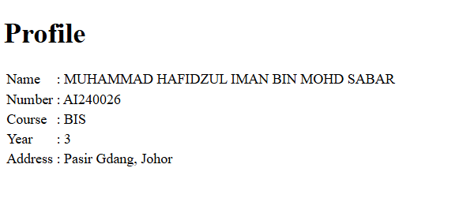
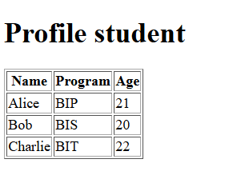

# Lab 5a: Server-Side Scripting (PHP)

**Course:** BIC21203 Web Development
**Faculty:** Faculty of Computer Science and Information Technology, UTHM
**Name:** Muhammad Hafidzul Iman Bin Mohd Sabar
**Matric No.:** AI240026
**Course / Year:** BIS / Year 3

## About

This lab combines HTML tags with PHP scripting to build simple dynamic web pages. It covers declaring variables, working with an associative array and `foreach` loop, and doing a calculation, then displaying the results in the browser.

> **Note:** PHP is a server-side language, so these files will not render on GitHub Pages. To view them, run them locally with XAMPP (see below).

## Project Structure

```
lab_5a/
├── lab5a_q1.php
├── lab5a_q2.php
├── lab5a_q3.php
├── screenshots/
│   ├── Profile.png
│   ├── Profile_student.png
│   └── Area_of_Rectangle.png
└── README.md
```

## How to Run

1. Install and open [XAMPP](https://www.apachefriends.org/), then start the **Apache** web server.
2. Copy the `lab_5a` folder into XAMPP's `htdocs` directory.
3. Open your browser and visit:
   - `http://localhost/lab_5a/lab5a_q1.php`
   - `http://localhost/lab_5a/lab5a_q2.php`
   - `http://localhost/lab_5a/lab5a_q3.php`

---

## Question 1: Display Personal Details (`lab5a_q1.php`)

Stores my details in PHP variables and displays them in an HTML table.

| Variable | Detail |
|----------|--------|
| `$name` | Full name |
| `$number` | Matric number |
| `$course` | Course |
| `$Yearofstudy` | Year of study |
| `$address` | Address |

- A PHP `echo` prints the `<h1>Profile</h1>` heading.
- Each variable is printed inside a table cell using `<?php echo "$variable"; ?>`.

**Output:**



---

## Question 2: Student Table with `foreach` (`lab5a_q2.php`)

Defines a `$student` array of associative arrays (name, program, age) for three students: Alice, Bob and Charlie. A `foreach` loop generates one table row per student.

- The table uses `border="1"` with `Name`, `Program` and `Age` header cells.
- `<?php foreach ($student as $profile): ?>` loops through the array, and each field is printed with `echo $profile['name']`, `$profile['program']` and `$profile['age']`.

**Output:**



---

## Question 3: Area of a Rectangle (`lab5a_q3.php`)

Calculates the area of a rectangle from a length and a width and displays the result.

| Variable | Value |
|----------|-------|
| `$length` | 10 |
| `$width` | 5 |
| `$area` | `$length * $width` = 50 |

The result is printed inside an `<h1>` heading using `echo`.

**Output:**


---

## Concepts Practised

- Embedding PHP inside HTML with `<?php ... ?>`
- Variables and string output with `echo`
- Arrays and associative arrays
- `foreach` loop with alternative syntax (`foreach: ... endforeach;`)
- Arithmetic operators
- Building HTML tables dynamically
# -bic21203-lab5a-javascript
